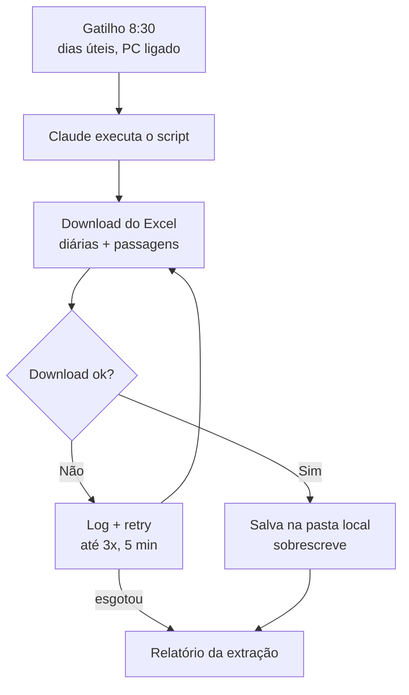

# ✈️ Gov Travel Insights

> 🚧 **Projeto em construção** — fase atual: extração automática

Pipeline que extrai diariamente os dados de **diárias e passagens aéreas** do [Portal da Transparência do Estado de São Paulo](https://www.transparencia.sp.gov.br/home/diarias), com o **Claude** como ativador, para analisar os gastos com viagens dos servidores públicos estaduais.

## 🎯 Objetivo

Identificar padrões de gastos: órgãos que mais gastam, destinos mais frequentes, sazonalidade e valores fora do padrão.

## 📌 Escopo

### Fase 1 — Extração (atual)

| Item | Definição |
|---|---|
| Fonte | Planilha Excel de diárias e passagens do Portal da Transparência SP |
| Abrangência | Todos os órgãos, sem filtro |
| Frequência | Dias úteis, às 8:30 (o portal é atualizado quase diariamente) |
| Gatilho | Tarefa agendada do Claude, que apenas executa o script local |
| PC desligado | Execução do dia é pulada |
| Execução | Script Python rodando na máquina local |
| Armazenamento | Pasta em `Documentos`; o arquivo é **sobrescrito** a cada execução |
| Falhas | 3 tentativas, intervalo de 5 min; falha registrada em log e no relatório |
| Relatório | Status, nome do arquivo, nº de linhas, tamanho e diferença de linhas vs. execução anterior |
| Fora do escopo | Tratamento, filtros e análise dos dados |

### Fluxo

### Próximas fases

1. **Filtro Detran** — restringir os dados ao Detran-SP
2. **Tratamento** — limpeza, padronização de tipos e deduplicação
3. **Análise** — indicadores e dashboard sobre os dados tratados

## ⏳ Pendências

- [ ] Identificar o link/requisição real de download do Excel (link direto ou automação de navegador)
- [ ] Definir o caminho da pasta em `Documentos`

## 🛠️ Tecnologias

- Python
- Pandas
- Claude (ativação diária)

## 📄 Fonte dos dados

Dados públicos do [Portal da Transparência do Estado de São Paulo](https://www.transparencia.sp.gov.br/home/diarias) — Controladoria Geral do Estado (CGE-SP).

---
